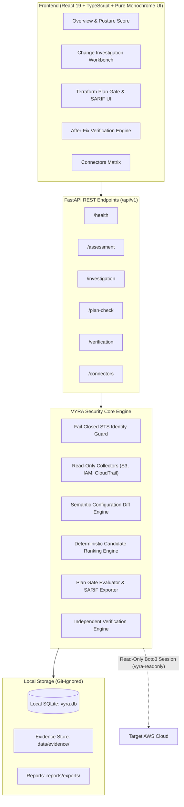

# VYRA — Cloud Security Workbench

<div align="center">

[](https://opensource.org/licenses/MIT)
[](https://www.python.org/)
[](https://github.com/vyra-security/platform)
[](https://github.com/astral-sh/ruff)
[](https://github.com/PyCQA/bandit)
[](https://github.com/vyra-security/platform)

**Find the change. Prevent the regression. Verify the fix.**

*A production-minded cloud security engineering workbench for AWS posture evaluation, root-cause change investigation, pre-deployment Terraform regression gates, and independent after-fix verification.*

[Quickstart](#-quickstart-in-60-seconds) •
[Three Test-Drive Paths](#-three-test-drive-paths) •
[Security Boundaries](#-security-boundaries--fail-closed-guards) •
[CLI Reference](#-cli-reference) •
[Capability Matrix](#-collector-capability--least-privilege-iam-matrix) •
[Documentation](#-architecture--core-workflows)

</div>

---

## 🧭 Why VYRA?

When a cloud resource becomes insecure, a security engineer needs to answer four critical questions:
1. **What changed?** Which API operation, actor, or configuration drift introduced the regression?
2. **How severe is it?** Do active threat findings or service posture amplify the urgency?
3. **How do we prevent recurrence?** Can we catch and block this regression in pull requests *before* `terraform apply`?
4. **Did the remediation actually work?** Can we independently re-verify live state rather than manually checking a box?

VYRA bridges posture evaluation, CloudTrail event attribution, shift-left Terraform plan gates with OASIS SARIF v2.1.0 output, and read-only verification in one unified workbench.

---

## ⚡ Quickstart in 60 Seconds

### Instant Launch (Default: Safe Offline Demo Mode)

No AWS credentials or cloud setup required. VYRA defaults to 100% offline synthetic benchmark fixtures.

#### Windows (PowerShell):
```powershell
git clone https://github.com/vyra-security/platform.git
cd platform
.\start-vyra.ps1
```

#### macOS / Linux (Bash):
```bash
git clone https://github.com/vyra-security/platform.git
cd platform
chmod +x start-vyra.sh
./start-vyra.sh
```

- **Web UI:** [http://127.0.0.1:5173](http://127.0.0.1:5173) (or run `npm run dev` in `frontend/`)
- **API Server & OpenAPI Docs:** [http://127.0.0.1:8000/docs](http://127.0.0.1:8000/docs)

---

## 🎯 Three Test-Drive Paths

### Path 1: 60-Second Offline Demo (Instant Browser UI)
1. Start VYRA via `./start-vyra.sh` or `.\start-vyra.ps1`.
2. Open the monochrome console at `http://127.0.0.1:5173`.
3. Explore the Overview metrics, Findings taxonomy, Asset Inventory, Root-Cause Investigation sessions, and After-Fix Verification.
4. **Zero AWS network calls occur.** All data originates from clean, synthetic benchmark fixtures (`112233445566`).

### Path 2: Local Live AWS Assessment (Safe, Fail-Closed, Read-Only)
1. Ensure your local AWS CLI is configured with the dedicated read-only profile:
   ```bash
   aws configure --profile vyra-readonly
   ```
2. Set your expected 12-digit AWS account ID in `.env`:
   ```env
   AWS_PROFILE=vyra-readonly
   AWS_DEFAULT_REGION=ap-south-1
   VYRA_EXPECTED_AWS_ACCOUNT_ID=123456789012
   ALLOW_LIVE_COLLECTION=true
   ```
3. Run a live assessment from the UI or CLI:
   ```bash
   python -m backend.app.cli assess --mode LIVE_AWS
   ```
4. **Fail-Closed Protection:** If the profile is missing, caller identity fails, or the account ID does not match `123456789012`, execution halts immediately before inspecting any resource.

### Path 3: Pre-Deployment Terraform Security Gate (CI/CD SARIF)
Evaluate Terraform execution plans before deployment to block security regressions:
```bash
# 1. Generate plan JSON
terraform plan -out=tfplan.binary
terraform show -json tfplan.binary > tfplan.json

# 2. Run VYRA Security Gate (terminal summary table)
python -m backend.app.cli plan-check --plan tfplan.json --fail-on high

# 3. Export OASIS SARIF v2.1.0 for GitHub Security tab
python -m backend.app.cli plan-check --plan tfplan.json --format sarif --output vyra.sarif
```

---

## 🛡️ Security Boundaries & Fail-Closed Guards

| Security Boundary | Technical Guarantee |
| :--- | :--- |
| **Strict Read-Only** | Only calls read-only APIs (`Describe*`, `List*`, `Get*`). Never mutates, deletes, or creates AWS resources. |
| **Zero S3 Object Access** | Only queries bucket-level configuration metadata. **Never reads or downloads object contents (`s3:GetObject`)**. |
| **Zero Secret Exposure** | Never extracts or logs IAM secret keys, tokens, or credentials. Automated recursive regex sanitization masks sensitive data. |
| **Fail-Closed Identity** | Requires named profile `vyra-readonly` and validates STS caller identity against `VYRA_EXPECTED_AWS_ACCOUNT_ID`. Never falls back to default ambient credentials. |
| **Zero Auto-Enabled Billing** | When optional security services (GuardDuty, Security Hub, Config) are disabled, VYRA records `NOT_SUBSCRIBED` and never auto-provisions paid detectors. |
| **Data Isolation** | Offline Demo Mode makes **zero outbound network calls**. Demo and live records are strictly isolated by assessment run ID. |

---

## 📊 Collector Capability & Least-Privilege IAM Matrix

| Service | Primary Operations Called | Least-Privilege IAM Action | Telemetry Depth & Operational Scope |
| :--- | :--- | :--- | :--- |
| **AWS STS** | `GetCallerIdentity` | `sts:GetCallerIdentity` | **Status Only**: Authenticates caller ARN and verifies expected account ID. Fail-closed. |
| **Amazon S3** | `ListBuckets`, `GetBucketLocation`, `GetPublicAccessBlock`, `GetBucketEncryption`, `GetBucketVersioning`, `GetBucketPolicyStatus`, `GetBucketLogging` | `s3:ListAllMyBuckets`, `s3:GetBucketLocation`, `s3:GetBucketPublicAccessBlock`, `s3:GetEncryptionConfiguration`, `s3:GetBucketVersioning`, `s3:GetBucketPolicyStatus`, `s3:GetBucketLogging` | **Posture Evaluation**: Metadata-only evaluation. Strictly read-only; never accesses, inspects, or downloads S3 object contents (`s3:GetObject` is completely excluded). |
| **AWS IAM** | `GetAccountSummary`, `GetAccountPasswordPolicy`, `ListUsers`, `ListMFADevices`, `ListAccessKeys`, `ListAttachedUserPolicies`, `ListUserPolicies`, `ListRoles`, `ListAttachedRolePolicies` | `iam:GetAccountSummary`, `iam:GetAccountPasswordPolicy`, `iam:ListUsers`, `iam:ListMFADevices`, `iam:ListAccessKeys`, `iam:ListAttachedUserPolicies`, `iam:ListUserPolicies`, `iam:ListRoles`, `iam:ListAttachedRolePolicies` | **Posture Evaluation**: Audits credential hygiene, MFA adoption, access key ages, and role attachments. Never extracts secret keys, credentials, or inline policy payloads. |
| **AWS CloudTrail** | `DescribeTrails`, `GetTrailStatus`, `GetEventSelectors`, `LookupEvents` | `cloudtrail:DescribeTrails`, `cloudtrail:GetTrailStatus`, `cloudtrail:GetEventSelectors`, `cloudtrail:LookupEvents` | **Events Looked Up**: Posture assessment checks trail status. Investigation sessions correlate management events (up to 90-day retention) to determine root-cause changes. |
| **AWS Config** | `DescribeConfigurationRecorders`, `DescribeConfigurationRecorderStatus`, `DescribeDeliveryChannels`, `GetResourceConfigHistory` | `config:DescribeConfigurationRecorders`, `config:DescribeConfigurationRecorderStatus`, `config:DescribeDeliveryChannels`, `config:GetResourceConfigHistory` | **Config History**: Queries historical configuration snapshots during root-cause investigations. Only active if a recorder was enabled. |
| **AWS Security Hub** | `DescribeHub`, `GetEnabledStandards`, `GetFindings` | `securityhub:DescribeHub`, `securityhub:GetEnabledStandards`, `securityhub:GetFindings` | **Findings Retrieved**: Inspects hub enrollment, standards, and queries active findings filtered by resource ID (max 25). Zero mutation. |
| **Amazon GuardDuty** | `ListDetectors`, `GetDetector`, `ListFindings`, `GetFindings` | `guardduty:ListDetectors`, `guardduty:GetDetector`, `guardduty:ListFindings`, `guardduty:GetFindings` | **Findings Retrieved**: Evaluates detector status and retrieves active threat findings. Never auto-provisions detectors. |
| **IAM Access Analyzer** | `ListAnalyzers`, `ListFindings` | `access-analyzer:ListAnalyzers`, `access-analyzer:ListFindings` | **Findings Retrieved**: Lists active analyzers and retrieves external access findings for cross-account exposure analysis. |
| **Amazon Inspector** | `BatchGetAccountStatus`, `ListCoverage`, `ListFindings` | `inspector2:BatchGetAccountStatus`, `inspector2:ListCoverage`, `inspector2:ListFindings` | **Findings Retrieved**: Checks Inspector v2 enablement and retrieves active vulnerability findings (CVEs). |
| **Amazon Macie** | `GetMacieSession`, `DescribeBuckets`, `ListFindings` | `macie2:GetMacieSession`, `macie2:DescribeBuckets`, `macie2:ListFindings` | **Findings Retrieved**: Inspects Macie session status and queries sensitive data discovery findings without reading S3 objects. |
| **AWS Systems Manager** | `DescribeInstanceInformation`, `DescribeInstancePatches` | `ssm:DescribeInstanceInformation`, `ssm:DescribeInstancePatches` | **Workload Inventory**: Enumerates managed EC2 instance inventory and evaluates patch compliance state. Never executes mutating agent commands. |
| **Amazon CloudWatch** | `DescribeAlarms`, `DescribeLogGroups` | `cloudwatch:DescribeAlarms`, `logs:DescribeLogGroups` | **Metrics & Alarms**: Queries security-relevant metric alarm states and verifies CloudTrail log group ingestion. Never scrapes high-cardinality metric data. |

---

### Minimal Least-Privilege IAM Policy for `vyra-readonly`

This production-grade least-privilege policy can be attached to the dedicated `vyra-readonly` IAM user or role. Where AWS supports resource-level permissions, statements are strictly scoped to resource ARN patterns. Broad `"Resource": "*"` wildcards are restricted solely to account-level listing and discovery APIs where mandated by the AWS IAM evaluation engine.

```json
{
  "Version": "2012-10-17",
  "Statement": [
    {
      "Sid": "VyraInventoryAndGlobalReadOnly",
      "Effect": "Allow",
      "Action": [
        "access-analyzer:ListAnalyzers",
        "cloudtrail:DescribeTrails",
        "cloudtrail:LookupEvents",
        "cloudwatch:DescribeAlarms",
        "config:DescribeConfigurationRecorderStatus",
        "config:DescribeConfigurationRecorders",
        "config:DescribeDeliveryChannels",
        "config:GetResourceConfigHistory",
        "guardduty:ListDetectors",
        "guardduty:ListFindings",
        "iam:GetAccountPasswordPolicy",
        "iam:GetAccountSummary",
        "iam:ListRoles",
        "iam:ListUsers",
        "inspector2:BatchGetAccountStatus",
        "inspector2:ListCoverage",
        "inspector2:ListFindings",
        "macie2:DescribeBuckets",
        "macie2:GetMacieSession",
        "macie2:ListFindings",
        "s3:ListAllMyBuckets",
        "securityhub:GetEnabledStandards",
        "ssm:DescribeInstanceInformation",
        "ssm:DescribeInstancePatches",
        "sts:GetCallerIdentity"
      ],
      "Resource": "*"
    },
    {
      "Sid": "VyraS3BucketPostureReadOnly",
      "Effect": "Allow",
      "Action": [
        "s3:GetBucketLocation",
        "s3:GetBucketLogging",
        "s3:GetBucketPolicyStatus",
        "s3:GetBucketPublicAccessBlock",
        "s3:GetBucketVersioning",
        "s3:GetEncryptionConfiguration"
      ],
      "Resource": "arn:aws:s3:::*"
    },
    {
      "Sid": "VyraIAMUserPostureReadOnly",
      "Effect": "Allow",
      "Action": [
        "iam:ListAccessKeys",
        "iam:ListAttachedUserPolicies",
        "iam:ListMFADevices",
        "iam:ListUserPolicies"
      ],
      "Resource": "arn:aws:iam::*:user/*"
    },
    {
      "Sid": "VyraIAMRolePostureReadOnly",
      "Effect": "Allow",
      "Action": [
        "iam:ListAttachedRolePolicies"
      ],
      "Resource": "arn:aws:iam::*:role/*"
    },
    {
      "Sid": "VyraCloudTrailTrailPostureReadOnly",
      "Effect": "Allow",
      "Action": [
        "cloudtrail:GetEventSelectors",
        "cloudtrail:GetTrailStatus"
      ],
      "Resource": "arn:aws:cloudtrail:*:*:trail/*"
    },
    {
      "Sid": "VyraSecurityHubPostureReadOnly",
      "Effect": "Allow",
      "Action": [
        "securityhub:DescribeHub",
        "securityhub:GetFindings"
      ],
      "Resource": "arn:aws:securityhub:*:*:hub/default"
    },
    {
      "Sid": "VyraGuardDutyDetectorPostureReadOnly",
      "Effect": "Allow",
      "Action": [
        "guardduty:GetDetector",
        "guardduty:GetFindings"
      ],
      "Resource": "arn:aws:guardduty:*:*:detector/*"
    },
    {
      "Sid": "VyraAccessAnalyzerPostureReadOnly",
      "Effect": "Allow",
      "Action": [
        "access-analyzer:ListFindings"
      ],
      "Resource": "arn:aws:access-analyzer:*:*:analyzer/*"
    },
    {
      "Sid": "VyraCloudWatchLogsRetentionReadOnly",
      "Effect": "Allow",
      "Action": [
        "logs:DescribeLogGroups"
      ],
      "Resource": "arn:aws:logs:*:*:log-group:*"
    }
  ]
}
```

> [!NOTE]
> **Resource ARN Scoping & Justification Summary**:
> - **Wildcard Justification (`Resource: *`)**: The AWS IAM authorization engine does not support resource ARN restrictions on account-level listing or discovery operations (e.g. `sts:GetCallerIdentity`, `s3:ListAllMyBuckets`, `iam:ListUsers`, `iam:ListRoles`, `cloudtrail:DescribeTrails`, `cloudtrail:LookupEvents`, `inspector2:*`, `macie2:*`, `guardduty:ListDetectors`, and `guardduty:ListFindings`). These APIs require `"Resource": "*"`.
> - **S3 Bucket Scoping**: S3 bucket posture actions (`s3:GetBucket*`, `s3:GetEncryptionConfiguration`) are strictly scoped to bucket ARNs (`arn:aws:s3:::*` or explicit organization bucket ARNs).
> - **IAM Entity Scoping**: Credential hygiene checks (`iam:ListMFADevices`, `iam:ListAccessKeys`, `iam:ListAttachedUserPolicies`) are scoped to IAM user ARNs (`arn:aws:iam::*:user/*`), and role attachment checks are scoped to IAM role ARNs (`arn:aws:iam::*:role/*`).
> - **Security Services Scoping**: Finding queries, detector checks, and trail status are narrowed directly to their service resource ARNs (`trail/*`, `detector/*`, `analyzer/*`, `hub/default`, and `log-group:*`).
> - **Zero Object & Secret Access Guarantee**: VYRA never requests or uses `s3:GetObject`, `iam:GetUserPolicy`, `iam:GetRolePolicy`, `secretsmanager:GetSecretValue`, or `ssm:GetParameter`. Data payloads, inline policies, and credentials are never accessed.

---

## 💻 CLI Reference

The unified `vyra` CLI provides developer-friendly terminal controls:

```bash
# Display version and tagline
python -m backend.app.cli version

# Start the local API platform server
python -m backend.app.cli start --host 127.0.0.1 --port 8000

# Run pre-deployment Terraform security gate
python -m backend.app.cli plan-check --plan tfplan.json --format table --fail-on high

# Export SARIF 2.1.0 report
python -m backend.app.cli plan-check --plan tfplan.json --format sarif --output results.sarif

# Trigger an offline DEMO assessment from terminal
python -m backend.app.cli assess --mode DEMO

# Trigger an authorized LIVE AWS assessment
python -m backend.app.cli assess --mode LIVE_AWS
```

---

## 🏛️ Architecture & Core Workflows



### Pre-Deployment Security Gate Rules

| Rule ID | Rule Name | Severity | Default Action | Target Resource |
| :--- | :--- | :--- | :--- | :--- |
| `VYRA-GATE-S3-001` | S3 Public Access Block Disabled/Deleted | **CRITICAL** | `BLOCKED` | `aws_s3_bucket_public_access_block` |
| `VYRA-GATE-S3-002` | Server-Side Encryption Removed/Missing | **HIGH** | `BLOCKED` | `aws_s3_bucket_server_side_encryption_configuration` |
| `VYRA-GATE-IAM-001` | Wildcard Admin Permissions (`*:*`) | **CRITICAL** | `BLOCKED` | `aws_iam_policy`, `aws_iam_role_policy`, `aws_iam_user_policy` |
| `VYRA-GATE-SEC-001` | Sensitive Ports Open to Internet (`0.0.0.0/0`) | **HIGH** | `BLOCKED` | `aws_security_group`, `aws_security_group_rule` |

---

## 🧪 Testing & Quality Assurance

VYRA ships with an offline acceptance test suite guaranteeing all security invariants:

```bash
# Run full offline test suite (85 tests passing in ~3s)
pytest -v

# Run the 18-point acceptance suite specifically
pytest backend/tests/test_offline_release_acceptance.py -v

# Run code style and security audits
ruff check backend/
bandit -r backend/app -ll

# Run frontend lint and build
cd frontend
npm run lint
npm run build
```

---

## 📄 License & Community

- **License:** [MIT License](LICENSE)
- **Security Policy:** [SECURITY.md](SECURITY.md)
- **Contributing Guide:** [CONTRIBUTING.md](CONTRIBUTING.md)
- **Changelog:** [CHANGELOG.md](CHANGELOG.md)

---

<div align="center">
<sub>VYRA — Built by and for cloud security engineers.</sub>
</div>
